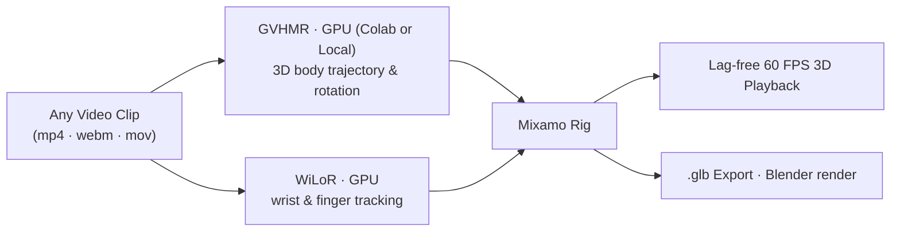

<h1 align="center">Mocaply</h1>

<p align="center">
  <b>Load any video clip. AI extracts the full 3D motion, fingers included, and any rigged 3D character performs it in real time.</b><br>
  A video from your camera, phone, or internet extracts high-precision 3D human motion via GPU-accelerated GVHMR + WiLoR. Enjoy lag-free 60 FPS in-browser rendering with zero CPU bottleneck. Export directly to GLB for Blender or game engines.
</p>

<p align="center">
  <a href="https://github.com/liladhiee-web/Mocaply"></a>
  <a href="https://colab.research.google.com/github/liladhiee-web/Mocaply/blob/main/mocaply_colab.ipynb"></a>
  <a href="#license"></a>
</p>

<p align="center">
  <video src="demo.mp4" controls="controls" width="100%" style="max-width: 800px; border-radius: 8px;">
    <source src="demo.mp4" type="video/mp4">
    Your browser does not support the video tag. Watch <a href="demo.mp4">demo.mp4</a> directly.
  </video>
</p>

---

## How It Works



| Stage | Where | Time |
|---|---|---|
| **HQ** 3D motion: GVHMR → SMPL rotations → Mixamo rig | GPU worker (Free Google Colab or Local) | ~3.5–4s (per 5s clip) |
| **Fingers**: WiLoR / MANO hand tracking | GPU worker | +~0.3s |
| **Playback**: Synchronized video + 3D rigged character | Browser (WebGL Three.js) | Lag-free 60 FPS (<0.1ms/frame) |

### Grounding

GVHMR reconstructs motion in a world frame whose floor is not guaranteed to
match `y = 0`. The pipeline now reconstructs that floor as well:

1. `hq/worker.py` samples the lowest SMPL-X sole vertices across the clip and
   `hq/ground.py` fits a plane with RANSAC (rejecting walls, outliers and
   implausible tilts).
2. The browser rotates the whole motion so the plane normal becomes up and the
   plane sits on the stage floor (`public/grounding.js`).
3. A per-frame contact solver keeps planted feet on the floor (never sinking,
   never floating), preserves the flight arc of jumps, and removes horizontal
   foot sliding by correcting only the hips/root.

Bone rotations are never modified, so the recovered pose and motion stay
intact. The **Ground Plane Lock** toggle in the Motion Pipeline panel enables or
disables the correction.

```bash
npm test                 # grounding math (Node)
python hq/test_ground.py # plane fitting (stdlib only)
```

---

## Quick Start

### Option A: Run on Google Colab (Recommended — Free NVIDIA T4 GPU)

No local gaming/NVIDIA GPU required. Run both the GVHMR worker and the web interface in Google Colab, exposed over a free Cloudflare tunnel:

[](https://colab.research.google.com/github/liladhiee-web/Mocaply/blob/main/mocaply_colab.ipynb)

1. Open the [Mocaply Colab Notebook](mocaply_colab.ipynb).
2. Set Runtime to **T4 GPU** (**Runtime → Change runtime type → T4 GPU → Save**).
3. Run the setup and launch cells.
4. Click the generated **Cloudflare Tunnel URL** (`https://...trycloudflare.com`) to open Mocaply on your computer or phone!

---

### Option B: Run Locally

**Requirements:** Node.js 18+. For the HQ GPU worker: Windows or Linux, an NVIDIA GPU, Python 3.10+, and `ffmpeg` on PATH.

```bash
git clone https://github.com/liladhiee-web/Mocaply.git
cd Mocaply
node server.mjs               # → http://localhost:5177 (the live preview works immediately)
```

**HQ GPU Worker (Optional, for GVHMR 3D trajectory):**

* **Windows:**
  ```powershell
  hq\setup.ps1
  hq\.venv\Scripts\python hq\worker.py
  ```

* **Linux / WSL:**
  ```bash
  bash hq/setup.sh
  python3 hq/worker.py
  ```

---

## Features

- **Drag & Drop Upload:** Load any local `.mp4`, `.webm`, or `.mov` clip directly from your desktop.
- **Mixamo Rigging:** Built-in support for X Bot, Michelle, and Soldier, plus custom `.fbx` or `.glb` Mixamo character upload.
- **Finger Articulation:** WiLoR MANO hands or MediaPipe Hands fallback captures realistic finger poses and hand gestures.
- **Root Motion Recovery:** Automatic gravity-aware hip trajectory tracking preserves spatial movement.
- **Ground Plane Reconstruction:** The floor is fitted from the recovered SMPL-X soles, gravity-aligned, and locked with per-frame foot contact so the character does not float, sink, or slide.
- **GLB Export:** Download skinned characters with animated motion tracks ready for Blender, Unreal Engine, or Unity.

---

## Project Structure

| Path | Description |
|---|---|
| `server.mjs` | Zero-dependency Node.js HTTP server; serves static files, upload API, and reverse proxies the worker |
| `public/` | Frontend web application (Three.js stage, 3D retargeting engine, minimal editor UI) |
| `hq/worker.py` | FastAPI worker providing GVHMR SMPL 3D pose extraction |
| `hq/hands.py` | Full-resolution finger and hand tracking (WiLoR / MediaPipe) |
| `tools/colab_runner.py` | Automated Colab launcher with zero-config Cloudflare Tunneling |
| `mocaply_colab.ipynb` | Google Colab interactive notebook |

---

## Author & Maintainer

**Mocaply** is maintained and updated by [**liladhiee-web**](https://github.com/liladhiee-web).

---

## License & Acknowledgements

Mocaply's code is licensed under the [Apache-2.0 License](LICENSE).

Special thanks to [**blendi-remade/prompt2rig**](https://github.com/blendi-remade/prompt2rig) for the original project concept and foundational motion capture retargeting architecture that inspired Mocaply.

This project integrates and builds upon foundational computer vision research:
- [GVHMR](https://github.com/zju3dv/GVHMR) (ZJU3DV)
- [SMPL-X](https://smpl-x.is.tue.mpg.de/) (Max Planck Institute for Intelligent Systems)
- [WiLoR](https://github.com/rolpotamias/WiLoR)
- [Motion2MixamoRig](https://github.com/MaxLiu22/Motion2MixamoRig)
- [Three.js](https://threejs.org/)
